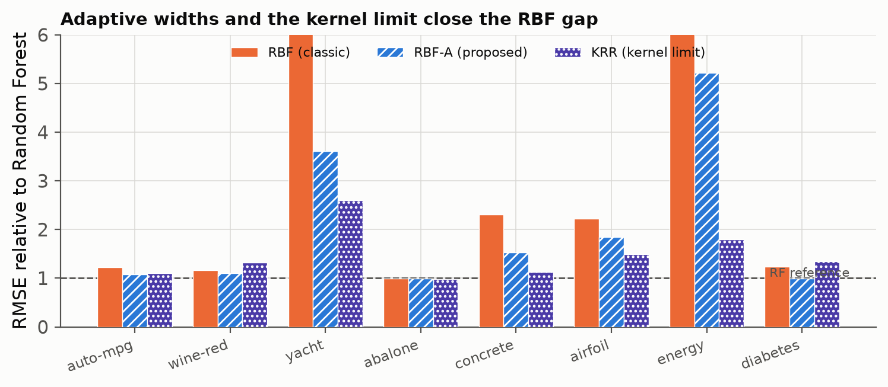
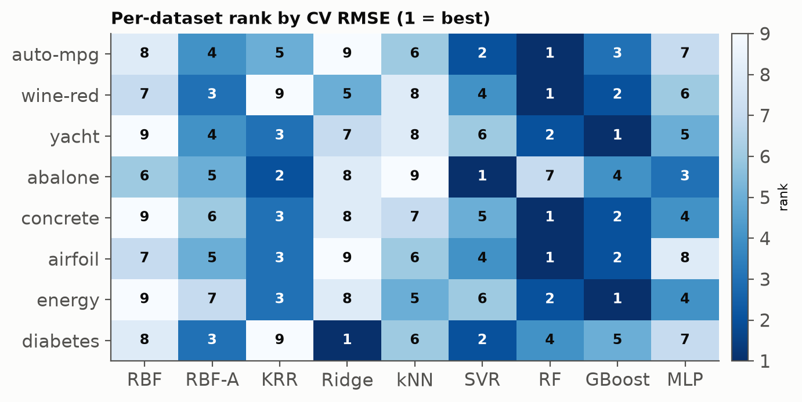
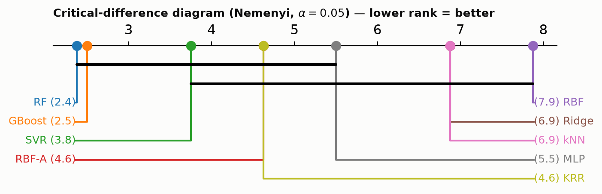

# Radial Basis Function Networks: A Reproducible Benchmark and the Role of Adaptive Widths

Reproducible code, data and results for a nine-model benchmark of radial basis
function (RBF) networks and classical regressors on eight real datasets — showing
that the textbook global-width RBF is the *weakest* model tested, diagnosing the
single global width as the cause, and closing most of the gap with per-centre
**adaptive widths** and the **kernel limit**.

[](LICENSE)
[](https://www.python.org/)
[](#citation)
[](#data)
[](#key-results)

This repository holds the **code, data and results**. The manuscript is under
review and is not mirrored here; the article will be linked once published.

* * *

## Overview

RBF networks are taught in every neural-networks course but are rarely benchmarked
reproducibly against the regressors practitioners actually use, and textbook
treatments leave an over-optimistic impression of their accuracy. This project puts
the classical Gaussian RBF network through a controlled, fully reproducible study
and asks: how does it *really* compare, and if it falls short, why — and can it be
fixed?

The answer is a clean three-step story:

1. On a smooth 1-D function the classical RBF matches a tuned MLP (its textbook
   reputation holds).
2. On **eight real tabular datasets** under 5-fold cross-validation it is the
   **weakest of nine models** — behind gradient boosting, random forests, SVR and
   even ridge regression (Friedman χ²=32.6, *p*<10⁻⁴; mean rank 7.9/9).
3. The cause is **not the architecture** but a single global width. Restoring
   **per-centre adaptive widths** (`RBF-A`) cuts the median error ~23% and the
   **kernel limit** (`KRR`) matches SVR.



*RMSE relative to a random forest (dashed line). The classical RBF (orange) is far
above the baseline on hard datasets; per-centre adaptive widths (blue) and the
kernel limit (violet) close most of the gap.*

* * *

## Key results

Cross-validated RMSE (mean over 5 folds; lower is better), **best per row in bold**:

| Dataset | n | d | RBF | RBF-A | KRR | Ridge | kNN | SVR | RF | GBoost | MLP |
|---|--:|--:|--:|--:|--:|--:|--:|--:|--:|--:|--:|
| auto-mpg | 396 | 6 | 3.28 | 2.88 | 2.93 | 3.47 | 3.02 | 2.77 | **2.67** | 2.83 | 3.10 |
| wine-red | 1599 | 11 | 0.67 | 0.63 | 0.76 | 0.65 | 0.68 | 0.65 | **0.57** | 0.62 | 0.67 |
| yacht | 308 | 6 | 10.38 | 3.68 | 2.65 | 9.10 | 10.25 | 7.57 | 1.02 | **0.77** | 6.16 |
| abalone | 4177 | 8 | 2.18 | 2.17 | 2.15 | 2.22 | 2.26 | **2.12** | 2.19 | 2.17 | 2.16 |
| concrete | 1030 | 8 | 11.69 | 7.77 | 5.69 | 10.50 | 9.19 | 7.19 | **5.07** | 5.21 | 5.99 |
| airfoil | 1503 | 5 | 4.02 | 3.34 | 2.70 | 4.83 | 3.57 | 3.18 | **1.81** | 2.68 | 4.21 |
| energy | 768 | 8 | 7.11 | 2.47 | 0.85 | 2.94 | 2.42 | 2.43 | **0.47** | **0.47** | 1.97 |
| diabetes | 442 | 10 | 71.35 | 56.87 | 77.15 | **54.83** | 59.14 | 55.54 | 57.55 | 58.27 | 61.19 |
| **Mean rank** | | | **7.9** | 4.6 | 4.6 | 6.9 | 6.9 | 3.8 | **2.4** | 2.5 | 5.5 |

Per-dataset ranks and the Nemenyi critical-difference diagram tell the same story:

<p align="center">
  
  
</p>

**Statistics** (Demšar protocol): Friedman χ²=32.57 (df=8), *p*=7.37×10⁻⁵. The
improvement of `RBF-A` over the classical RBF is significant after Holm correction
(Wilcoxon *p*=0.047); `KRR` is statistically indistinguishable from SVR (*p*=0.64).

* * *

## Method

Nine models are compared with fixed, reasonable defaults (an equally un-tuned,
out-of-the-box comparison) under 5-fold cross-validation with per-fold
standardisation:

| Family | Models |
|---|---|
| RBF family | **RBF** (classic, global width), **RBF-A** (per-centre adaptive width, *ours*), **KRR** (Gaussian kernel ridge) |
| Linear / instance | Ridge, k-NN, SVR (Gaussian kernel) |
| Ensembles / net | Random Forest, Gradient Boosting, MLP |

The RBF and RBF-A networks are implemented **from scratch** (K-means centres +
closed-form least-squares readout); `RBF-A` sets each centre's width to the mean
distance to its *k* nearest centres. Significance uses the Friedman test, a Nemenyi
post-hoc critical-difference diagram, and Holm-corrected Wilcoxon signed-rank tests.

* * *

## Repository structure

```text
src/
  rbf_benchmark.py     RBF, RBF-A and 6 baselines over 8 datasets → results/ + figures/
  rbf_stats.py         Friedman + Nemenyi (CD diagram) + Holm-Wilcoxon → results/ + figures/
  rbf_experiments.py   pedagogical 1-D experiment (RBF vs MLP) + figures
notebooks/
  rbf_vs_mlp_benchmark.ipynb   self-contained Colab notebook (downloads data, runs the demo)
data/                  the 8 public datasets used (UCI and open mirrors)
figures/               all generated figures (PNG)
results/               results_benchmark.json, stats_full.json (exact metrics)
```

## Installation

```bash
python -m venv .venv && source .venv/bin/activate
pip install -r requirements.txt
```

## Reproducing the results

Every number and figure is reproducible; all random seeds are fixed.

```bash
python src/rbf_experiments.py   # 1-D experiment + pedagogical figures
python src/rbf_benchmark.py     # full 8×9 benchmark → results/results_benchmark.json
python src/rbf_stats.py         # Friedman + Nemenyi + Wilcoxon → results/stats_full.json
```

Or open `notebooks/rbf_vs_mlp_benchmark.ipynb` in Google Colab and *Run all*.

## Data

Eight public regression datasets, all low-dimensional and small to moderate in
size (n = 308–4177, d = 5–11): **auto-mpg, wine-quality-red, yacht, abalone,
concrete, airfoil, energy** (UCI Machine Learning Repository and open mirrors) and
**diabetes** (bundled with scikit-learn). The exact copies used are in `data/`.

## Authors

- **Richar Andre Vilca-Solorzano** — [ORCID 0009-0003-2385-5263](https://orcid.org/0009-0003-2385-5263)
- **Dina Maribel Yana-Yucra** — [ORCID 0009-0003-6218-2735](https://orcid.org/0009-0003-6218-2735)
- **Alain Paul Herrera-Urtiaga** — [ORCID 0000-0003-1261-2605](https://orcid.org/0000-0003-1261-2605)
- **Milton Vladimir Mamani-Calisaya** — [ORCID 0000-0002-0676-0989](https://orcid.org/0000-0002-0676-0989) *(advisor)*

Faculty of Statistical and Informatics Engineering (FINESI), Universidad Nacional
del Altiplano, Puno, Peru.

## Citation

The manuscript is under review. Meanwhile, please cite this repository — see
[`CITATION.cff`](CITATION.cff) or:

```bibtex
@software{vilca2026rbf,
  author  = {Vilca-Solorzano, Richar Andre and Yana-Yucra, Dina Maribel and
             Herrera-Urtiaga, Alain Paul and Mamani-Calisaya, Milton Vladimir},
  title   = {Radial Basis Function Networks: A Reproducible Benchmark and the
             Role of Adaptive Widths},
  year    = {2026},
  url     = {https://github.com/Andre031222/rbf-adaptive-widths-benchmark}
}
```

## License

Released under the [MIT License](LICENSE). The datasets remain under their
original licenses (see `data/` and the sources above).
