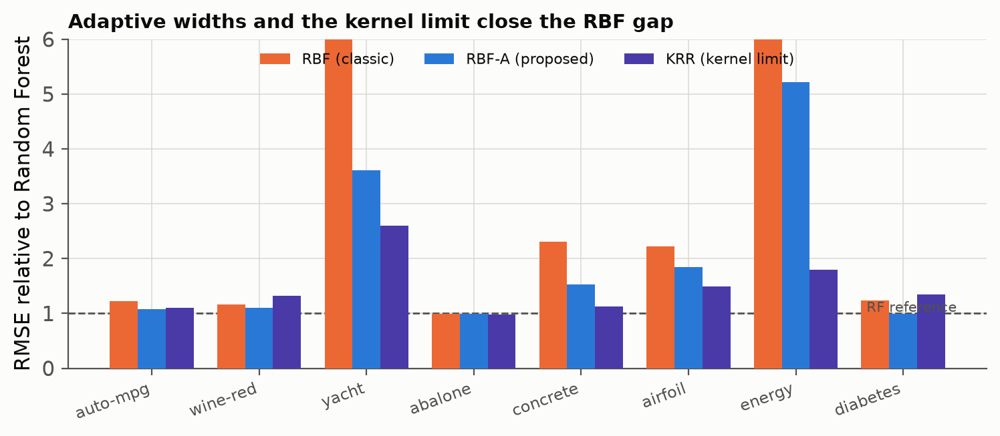

# Redes de Función de Base Radial: benchmark reproducible y el papel de las anchuras adaptativas

Código, datos y resultados reproducibles de un benchmark de nueve modelos de
regresión sobre ocho datasets reales — mostrando que la RBF clásica de **anchura
global** es el modelo **más débil**, diagnosticando la anchura global como la causa,
y cerrando la brecha con **anchuras adaptativas por-centro** y el **límite kernel**.

> *(English version: [README.md](README.md).)* Este repositorio contiene el
> **código, los datos y los resultados**. El manuscrito está en revisión y **no** se
> incluye aquí; el artículo se enlazará cuando se publique.

## Resumen

Las redes RBF se enseñan en todo curso de redes neuronales pero casi nunca se
comparan de forma reproducible, y los libros dejan una impresión demasiado
optimista. Aquí:

1. En una función suave 1-D la RBF clásica **iguala** a un MLP afinado.
2. En **ocho datasets tabulares reales** (CV de 5 pliegues) es el **peor de nueve
   modelos** — por detrás de gradient boosting, random forest, SVR e incluso ridge
   (Friedman χ²=32.6, *p*<10⁻⁴; rango medio 7.9/9).
3. El culpable es la **anchura global**, no la arquitectura. Las **anchuras
   adaptativas por-centro** (`RBF-A`) reducen el error mediano ~23% y el **límite
   kernel** (`KRR`) iguala a SVR.



## Reproducir

```bash
python -m venv .venv && source .venv/bin/activate
pip install -r requirements.txt
python src/rbf_experiments.py   # experimento 1-D + figuras
python src/rbf_benchmark.py     # benchmark 8×9 → results/
python src/rbf_stats.py         # Friedman + Nemenyi + Wilcoxon → results/
```

O abre `notebooks/rbf_vs_mlp_benchmark.ipynb` en Google Colab → *Ejecutar todo*.

## Autores

Richar Andre Vilca-Solorzano · Dina Maribel Yana-Yucra · Alain Paul Herrera-Urtiaga ·
Milton Vladimir Mamani-Calisaya *(asesor)* — FINESI, Universidad Nacional del
Altiplano, Puno, Perú.

## Licencia

[MIT](LICENSE). Los datasets conservan sus licencias originales.
